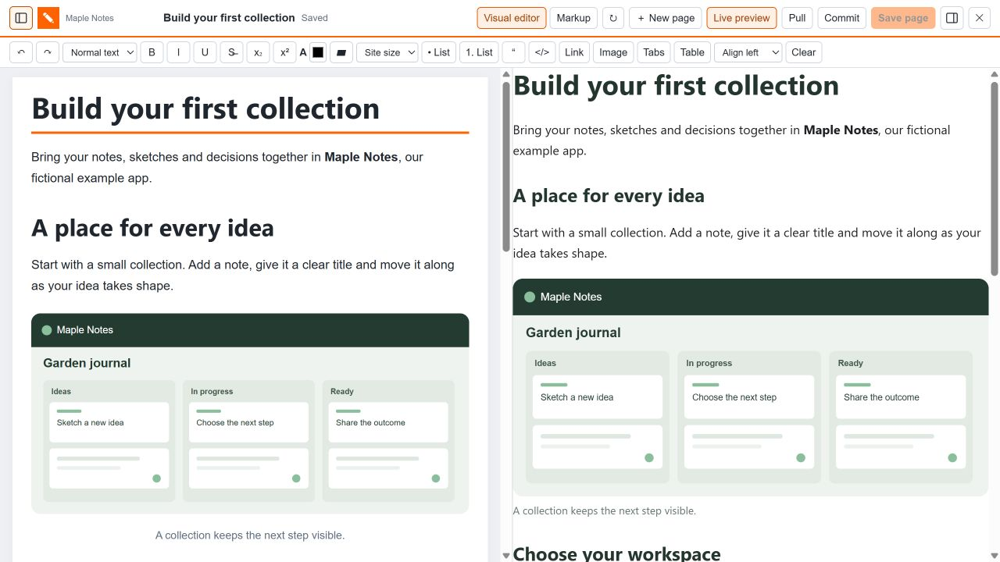
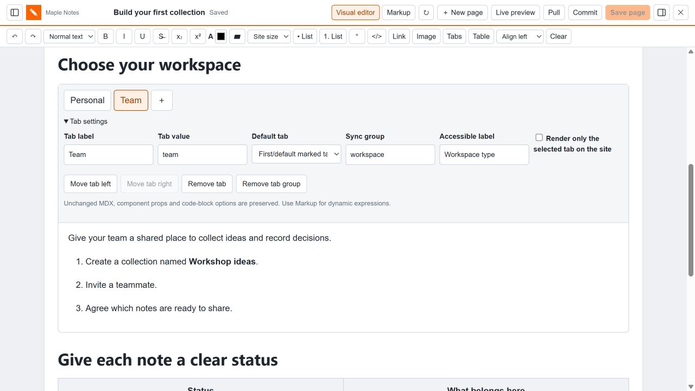
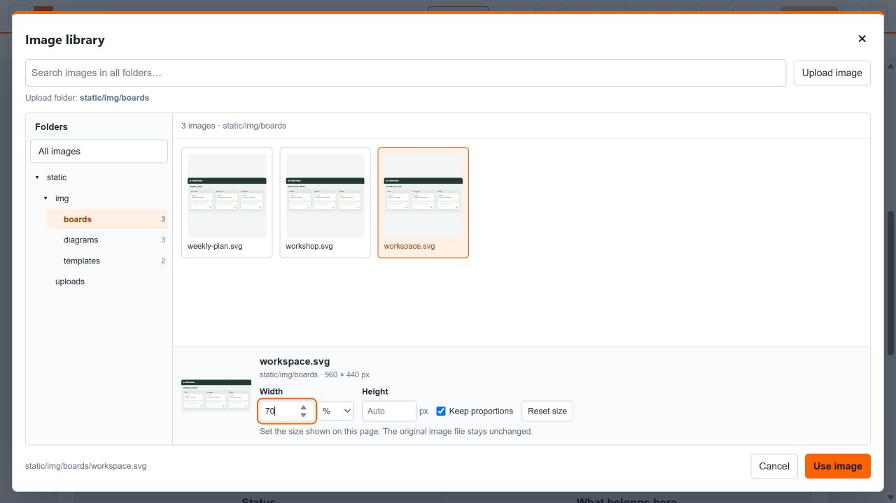
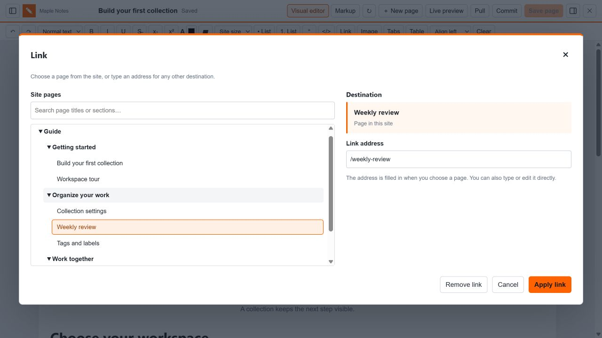
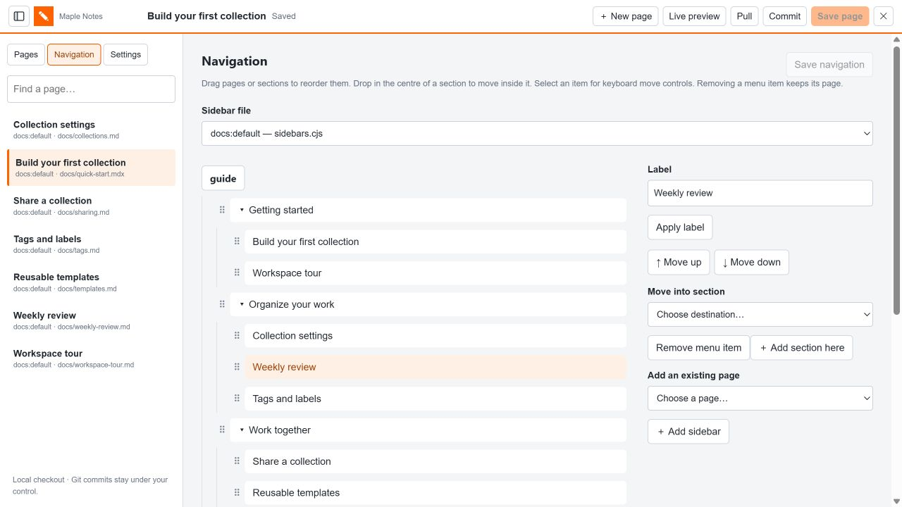
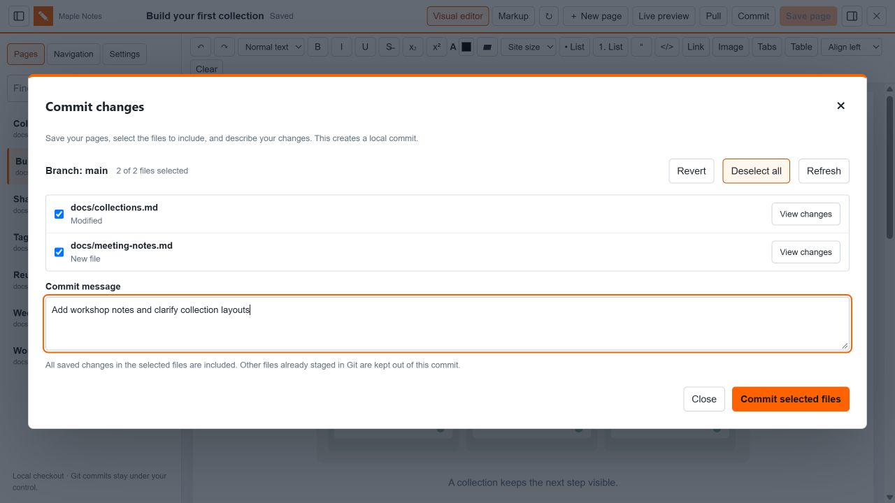

# Docsite Editor by pilcherd

WYSIWYG site editor plugin for use with Docusaurus.

A reusable local editing plugin for **Docusaurus 3.x**, Node 22+, and React 18/19. The editor lives in its own npm package and Git project. It edits the host site's source checkout through an in-page visual editor, source editor, image library and local Node API.

## See the editor in action

These screenshots use **Maple Notes**, a made-up documentation site with original sample artwork. Its content, workflow and commands are fictional; no customer content, accounts or real product data are shown.

### Write visually and check the result

Use the formatting toolbar for headings, lists, links, images and tables. **Live preview** shows the draft with the host site's styling. Hide either side panel when you want more room, or switch to **Markup** without saving.



### Edit tabbed instructions

Switch between tab panels and edit their contents directly. **Tab settings** lets you rename, add, remove and reorder tabs, choose a default and set a synchronization group. Standard Tabs and TabItem imports are managed for you.



### Find an image and choose its size

Browse the static asset folders on the left, search across all folders or upload into the selected folder. Set the display width and height before inserting an image; the original file keeps its resolution.



### Link to a page without typing its address

Choose a destination from the site's page tree. The link address is filled in automatically. You can still type an external URL, email address, relative address or section link.



### Arrange the site navigation

Add sections and existing pages, edit labels, or drag items to a new position. Changes stay in the navigation draft until you select **Save navigation**.



### Review saved work before committing

Select the files you want to include, inspect a diff and write a commit message. **Commit selected files** creates a local commit. **Revert** restores selected files after confirmation; **Pull** is beside **Commit** in the header.



To explore the same example from a repository checkout, run:

```bash
npm ci
npm run demo
```

Open [localhost:3012](http://localhost:3012), then choose **Edit page**. Stop the local example with Ctrl+C. The [example source](examples/maple-notes/README.md) contains seven small documentation pages and eight SVG illustrations.

## Install in a project

Download the package from the [v1.0.0 release](https://github.com/pilcherd/docsite-editor/releases/tag/v1.0.0), or clone this repository and build it locally:

```bash
npm ci
npm run check
npm pack
```

Install the resulting tarball in a Docusaurus project:

```bash
npm install --save-dev /path/to/pilcherd-docsite-editor-1.0.0.tgz
```

Register it alongside your existing plugins. For JavaScript/TypeScript configurations using CommonJS resolution:

```ts
plugins: [
  // Keep the site's existing plugins here.
  ...(process.env.DOCUSAURUS_SITE_EDITOR === '1'
    ? [[require.resolve('@pilcherd/docsite-editor'), {}]]
    : []),
],
```

Native ESM configurations can import the plugin:

```js
import siteEditor from '@pilcherd/docsite-editor';

export default {
  // Your existing site configuration.
  plugins: process.env.DOCUSAURUS_SITE_EDITOR === '1' ? [[siteEditor, {}]] : [],
};
```

Add these scripts to the host's package.json:

```json
{
  "edit": "docsite-editor",
  "edit:built": "docsite-editor --built"
}
```

Add `.docsite-editor/` to the host's `.gitignore`. Run `npm run edit` and click **Edit page** on any page. `npm run edit:built` builds and serves a local static version, then rebuilds after saves. Both bind to loopback on port 3000. Options:

```bash
npm run edit -- --port 3010
docsite-editor --site /path/to/checkout --config docusaurus.config.mjs --built
```

The editor requires the source checkout, installed host dependencies and a running local Node process. Static hosting alone cannot save source files. Stop it with Ctrl+C. Use **Commit** in the header to review saved files, choose what to include and enter a commit message. Pushing remains a separate Git operation.

## Discovery and customization

The plugin reads the host's loaded Docusaurus configuration and content metadata. It does not assume project-specific names, `docs/`, `static/img`, a particular homepage, TypeScript configuration or a stylesheet filename.

It discovers classic-preset and standard docs/blog/pages plugins, multiple docs instances, configured content paths, static directories, stylesheets, sidebar files and authoritative page URLs. Versioned and localized content roots are included when present. Paths must stay inside the source checkout; symlinks are not writable. For custom presets or unusual layouts, pass explicit options:

```ts
{
  // Optional overrides; normally inferred from the host.
  collections: [
    {
      type: 'docs', id: 'manual', label: 'Product manual',
      path: 'content/manual', routeBasePath: '/',
      sidebarPath: 'navigation/manual.cjs',
      include: ['**/*.{md,mdx}'],
      exclude: ['**/_*', '**/_*/**'],
    },
    {type: 'pages', id: 'pages', path: 'web/pages', routeBasePath: '/'},
    {type: 'blog', id: 'news', path: 'articles', routeBasePath: 'news'},
  ],
  mediaRoots: [
    {path: 'public-files', publicPath: '/', uploadPath: 'public-files/pictures'},
  ],
  colocatedMedia: true,
  stylesheets: ['theme/custom.css', 'theme/extra.css'],
  styles: [
    {label: 'Notice', className: 'my-notice'},
    {label: 'Caption', className: 'my-caption'},
  ],
  newPageDefaults: {hide_title: true},
  jsxRoot: 'main',
}
```

Collection IDs in the editor/API are `type:id`, such as `docs:manual`. Version/locale suffixes are added for additional source roots. `sidebarPath: false` means no sidebar. Without a sidebar file, folder-based navigation uses `_category_.json` files and page front matter. Content-adjacent image references remain supported when displaying existing documents. The library and uploads use only the configured Docusaurus static directories.

The default style palette and new-page front matter are empty. The host supplies its own classes and defaults. React pages can use any filename or folder. The editor selects the configured JSX root or an inline returned JSX element, preserving the rest of the module. Pages without safely identifiable JSX use source editing.

## Editing and preservation

- Headings, paragraphs, links, lists, code, colors, sizing, alignment, highlighting, superscript and subscript. The light authoring surface owns heading and code colours so host dark themes cannot make code unreadable; live preview uses the host site styles.
- Link dialog with a searchable page tree following the site sidebars, plus pages outside the sidebars. Choosing a page fills in a portable internal address; manual web, email, relative and section links remain editable. Selected text is preserved, and links inserted at the cursor use the chosen page title.
- Visual Tabs and TabItem support: switch and edit each panel, rename/add/remove/reorder tabs, and configure defaults, synchronization groups and lazy rendering. Standard theme imports are hidden and managed automatically, including aliases and new groups. Nested content, code-fence options and unknown MDX are preserved. Dynamic tab lists stay in source mode.
- Images, captions and HTML/GFM tables, retaining existing attributes.
- Image library with a folder tree, direct-folder browsing and uploads into the chosen folder. Search spans the configured Docusaurus static directories; empty folders are browsable. The tree starts at those static roots, including custom directory names. Content-adjacent images still render in existing documents but are not library or upload targets.
- Display width in pixels or percent, optional pixel height, proportion lock and size reset. Set sizes before inserting from the library or use the contextual controls when an editor image is selected. Resizing changes page markup and preserves the original image file.
- Visual/source switching without saving the draft.
- Closing the editor opens the currently edited page in the live view. Unsaved changes still require confirmation before closing.
- Click or select text in the live preview to locate it in the editor. The matching content is scrolled into view; selected text ranges are mirrored. Images and source-only components select their editor node. Markup mode selects the matching source block.
- Independent header toggles for navigation and page settings panels. Hidden panels free their full width for content; the preference is remembered locally and drafts stay intact.
- Front matter, page creation and collection selection.
- Multiple sidebar files, sections, labels, ordering, moving and existing-page insertion. Drag pages or sections before/after another item, into a section, or into another sidebar. Drop indicators show the destination; click **Save navigation** to apply the draft. Keyboard move controls remain available.
- Autogenerated sidebar sections through folder category metadata.
- Literal configuration settings, full configuration source, and multiple stylesheets.
- Imported MDX components and expressions retained as source blocks with property/text inspection.

Untouched blocks retain their original source. Dynamic JSX, custom directives and other constructs that cannot be represented faithfully remain source blocks rather than being flattened. Executable sidebars use source mode. Config files can be JS, TS, CJS or ESM and can export objects or functions; literal settings use forms when statically identifiable, with source editing otherwise.

Saves check revisions, reject concurrent disk changes, create recovery copies in `.docsite-editor/history`, and write atomically. Image uploads write immediately; page drafts wait for **Save page**. Built mode retains the last successful site if a new build fails. The host Docusaurus compiler remains authoritative for custom syntax and plugins.

## Local Git commits and reverts

**Commit** opens a changes dialog with file checkboxes, diff previews and a commit message. Save any editor drafts first. **Commit selected files** stages all saved changes in the chosen files and commits only those files. Unrelated staged files stay out of the commit.

**Revert**, left of **Select all**, restores the selected files to the last commit after an explicit confirmation. New files are removed; deleted files and staged renames are restored. Other working and staged changes stay untouched. Before reverting, the editor saves working-file and staged-file recovery copies under `.docsite-editor/history/git-revert-*`; the success message shows the folder. Save or discard editor drafts first.

The dialog detects changes made since review and asks you to refresh. It supports new files, deletions, staged renames and documentation nested inside a larger Git checkout. Existing Git author identity and hooks apply; failures are shown in the dialog. A failed commit may leave the chosen files staged so you can resolve the reported Git issue and retry. Committing does not push changes or contact a remote.

**Pull** sits beside **Commit** in the editor header. It downloads updates from the current branch’s configured upstream using fast-forward only, including when saved local edits or unsaved editor drafts exist. Git refuses incoming updates that would overwrite saved local files. Drafts stay open; if the same file changes on disk, the editor warns you and stale-save protection prevents overwriting the pulled version. A confirmation explains that conflicts or diverged branches must be resolved outside this UI. Pull does not push, create merge commits, run merge hooks, automatically stash files, install dependencies or resolve conflicts. Missing upstreams and detached HEAD states must be configured outside the editor.

## Project preview adapters

The sandboxed live preview bundles React/MDX and relative project components using the host's dependencies. It includes lightweight content adapters for common Docusaurus components (Link, Head, Layout, Tabs, TabItem, Admonition, Details and CodeBlock), base URLs, directives and local images. It suppresses document-head effects.

A site's custom theme contexts, webpack-only modules, third-party components or Markdown extensions may need explicit preview adapters. This is not a promise to visually model arbitrary JavaScript or every third-party plugin.

```ts
{
  previewModule: 'editor/preview.jsx',
  previewImports: {
    '@theme/SpecialCard': 'editor/SpecialCardPreview.jsx',
    '@company/runtime': 'editor/runtime-preview.js',
  },
  previewRemarkPlugins: ['editor/custom-remark.mjs'],
  previewImageOrigins: ['https://images.example.com'],
}
```

`editor/preview.jsx` exports an optional wrapper and MDX component map:

```jsx
import React from 'react';

export const components = {
  h1: (props) => <h1 {...props} className="my-doc-title" />,
};

export function PreviewRoot({ children }) {
  return <div className="my-document-theme">{children}</div>;
}
```

An adapter must provide the exports consumed by the original import. Preview adapters change only local rendering; original imports and source remain intact. Unresolved modules produce an actionable preview error. Add provider contexts in `PreviewRoot` when a custom component needs them. Custom remark modules export a unified remark plugin.

## Local access and release builds

The API requires loopback access, a localhost Host header, matching Origin and a session token for writes. File operations are restricted to configured content/config/sidebar/style/media paths and reject traversal and symlinks. It is a local authoring tool, not a public multiuser CMS; do not expose its API on a network.

The preview runs in a sandbox without form submission, same-origin access or network-fetch permission. Normal builds with the editor disabled contain neither its UI nor its write API. Production systems do not need the package to run the resulting static documentation.

## Develop and validate

```bash
npm ci
npm test
npm run build
TEST_DOCS_SITE=/path/to/installed/docusaurus/site npm run test:corpus
npm run test:site
npm pack
```

Unit/API tests use isolated temporary repositories, covering configuration formats, custom paths, multiple instances, versions/locales, media, conflict handling and component adapters. The corpus check performs exact visual/source round-trips and real edit-and-compile checks on the selected site's content. The site integration check creates a separate temporary Docusaurus site with custom folders, a URL prefix and two documentation instances; it tests built/dev editing and an editor-free release build.

Distribute the npm tarball or publish it to your organization's package registry. A sibling source checkout is not required. To develop against this checkout, a host may resolve `process.env.DOCUSAURUS_SITE_EDITOR_PLUGIN || '@pilcherd/docsite-editor'` in its local plugin registration.

## Trademarks and affiliation

This is an independent plugin maintained by pilcherd, not an official Meta or Docusaurus product. Docusaurus is referenced to identify compatible software. Its name and logo belong to their respective owners; the MIT license grants no rights to those marks. See [TRADEMARKS.md](TRADEMARKS.md) and the [Meta Open Source Trademark Policy](https://opensource.fb.com/legal/trademark/).

## License and release

MIT; see [LICENSE](LICENSE). Third-party libraries keep their own licenses; bundled notices are generated by the build in [THIRD_PARTY_NOTICES.txt](THIRD_PARTY_NOTICES.txt). No company account or service is required. Version 1.0.0 uses the `@pilcherd/docsite-editor` package and `docsite-editor` command. The `DOCUSAURUS_SITE_EDITOR` environment variable enables the local plugin; leave it unset in normal site builds.

See [CONTRIBUTING.md](CONTRIBUTING.md) for development, [SECURITY.md](SECURITY.md) for the local trust boundary, and [RELEASING.md](RELEASING.md) for package checks and a source-only release snapshot. Source and versioned release packages are hosted on [GitHub](https://github.com/pilcherd/docsite-editor). Installing a downloaded tarball does not require an npm registry publication.
